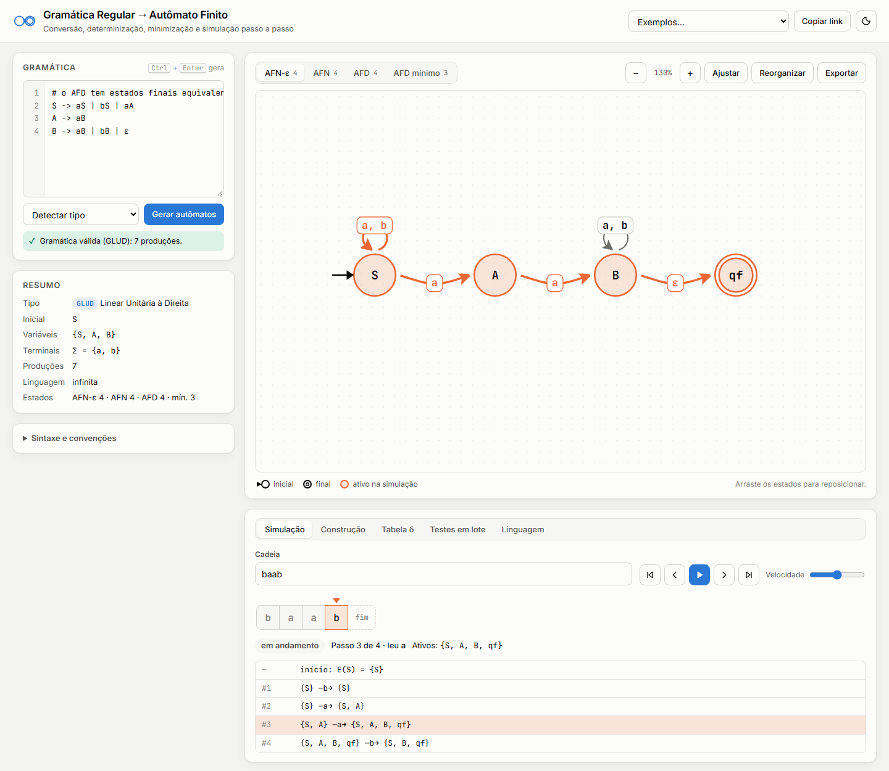
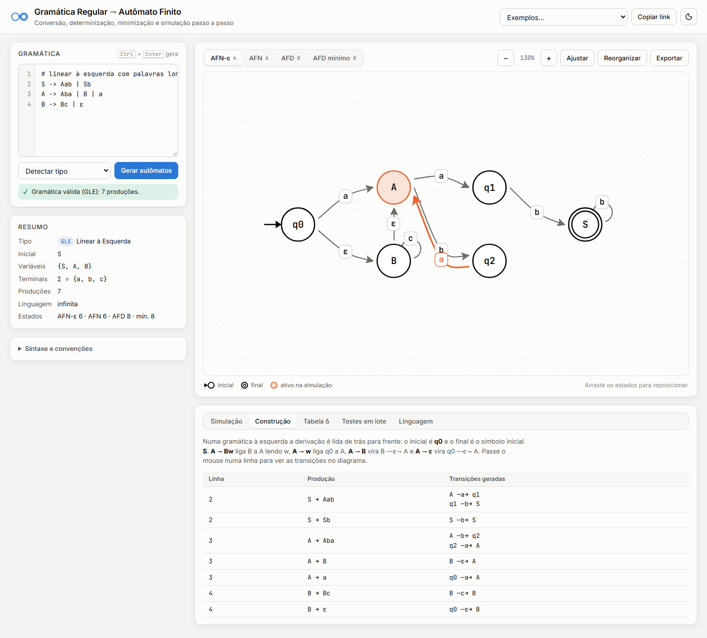
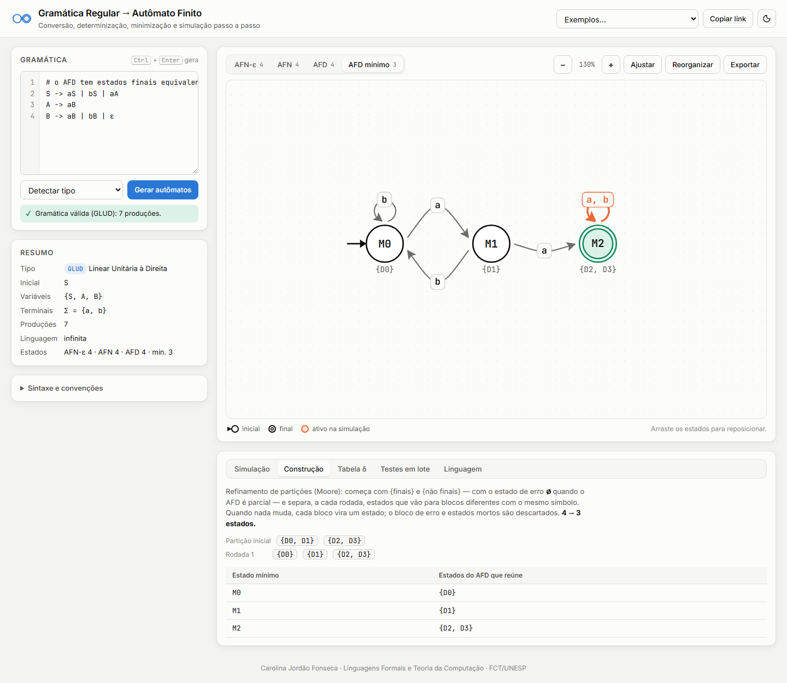
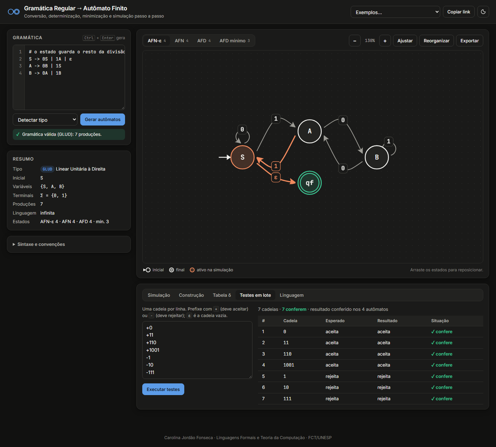

# Simulador de Gramática Regular → Autômato Finito

Ferramenta web para **Linguagens Formais e Teoria da Computação**. Ela lê uma gramática regular e mostra o caminho completo até o autômato mínimo: **AFN-ε → AFN → AFD → AFD mínimo**. Cada etapa tem diagrama, tabela de transição e explicação da construção. Em qualquer etapa dá para simular a leitura de uma cadeia passo a passo.

Funciona abrindo o `index.html` no navegador. Não precisa de servidor nem de build.



## Destaques

| Recurso | O que faz |
|---|---|
| Leitura da gramática | Aceita `->`, `→` e `::=`; alternativas com `\|`; continuação de linha; comentários com `#`; variáveis como `A1` e `B'`; terminais numéricos; `ε`, `λ`, `&` ou `eps` para a palavra vazia. Todos os erros aparecem juntos, com a linha. Clicar no erro seleciona a linha no editor. |
| Classificação | Detecta **GLD, GLE, GLUD e GLUE**, ou confere o tipo escolhido. Recusa gramáticas mistas (direita + esquerda), porque elas podem gerar linguagens não regulares. |
| Análise | Avisa sobre variáveis sem regra, inalcançáveis ou que nunca terminam, e sobre linguagem vazia. |
| Conversão GR → AFN-ε | Algoritmos para gramáticas à direita e à esquerda. Palavras longas (`A → abcB`) geram estados intermediários. A tabela mostra que transições cada produção gerou; passar o mouse destaca essas transições no diagrama. |
| Remoção de ε | `δ'(q, a) = E(δ(E(q), a))`, com a tabela de ε-fechos. |
| Determinização | Construção de subconjuntos. Cada estado do AFD mostra o conjunto do AFN que representa. |
| Minimização | Refinamento de partições (Moore), com as partições de cada rodada e os estados do AFD que cada estado mínimo reúne. |
| Simulação | Fita com cabeça de leitura, estados ativos e transições percorridas destacados, reprodução automática com velocidade ajustável, avanço e recuo passo a passo, e rastro clicável. Atalhos: `←`, `→`, `Home`, `End` e espaço. |
| Testes em lote | Uma cadeia por linha, com `+` (deve aceitar) e `-` (deve rejeitar). Cada cadeia é conferida nos 4 autômatos. |
| Linguagem | Diz se a linguagem é vazia, finita (quantas palavras) ou infinita. Lista as menores palavras aceitas. Gera a **gramática equivalente** a partir do AFD mínimo. Verifica a **equivalência com outra gramática** e mostra o menor contraexemplo. |
| Interface | Layout automático em camadas, laços desenhados do lado com mais espaço, zoom, reposicionamento por arraste, tema claro/escuro e layout para celular. |
| Exportação e compartilhamento | Graphviz (`.dot`), JSON e tabela δ em CSV. O botão **Copiar link** guarda gramática, cadeia, testes e visão na URL. |

## Como usar

1. Abra `index.html` no navegador (Chrome, Edge ou Firefox).
2. Escreva a gramática ou escolha um exemplo. O símbolo inicial é o lado esquerdo da primeira regra.
3. Clique em **Gerar autômatos** (ou `Ctrl + Enter`).
4. Alterne entre **AFN-ε, AFN, AFD e AFD mínimo** nas abas do diagrama.
5. Digite uma cadeia em **Simulação** e use os controles (vazio = ε).

```text
# número par de a
S -> aA | bS | ε
A -> aS | bA
```

## Algoritmos de conversão

**Linear à direita** (`A → wB | w | B | ε`). Os estados são as variáveis mais `qf`. O inicial é o símbolo inicial, e `qf` é o único final.

| Produção | Transições |
|---|---|
| `A → a₁…aₖB` | `A —a₁→ q₁ —a₂→ … —aₖ→ B` |
| `A → a₁…aₖ` | `A —a₁→ … —aₖ→ qf` |
| `A → B` | `A —ε→ B` |
| `A → ε` | `A —ε→ qf` |

**Linear à esquerda** (`A → Bw | w | B | ε`). A derivação é lida de trás para frente. Os estados são `q0` mais as variáveis. O inicial é `q0`, e o final é o símbolo inicial.

| Produção | Transições |
|---|---|
| `A → Ba₁…aₖ` | `B —a₁→ … —aₖ→ A` |
| `A → a₁…aₖ` | `q0 —a₁→ … —aₖ→ A` |
| `A → B` | `B —ε→ A` |
| `A → ε` | `q0 —ε→ A` |

Depois vêm a remoção de ε, a construção de subconjuntos (AFD parcial: o estado de erro ∅ fica implícito) e a minimização. A minimização completa o AFD com ∅, refina {finais, não finais} até estabilizar e descarta os estados mortos.

| Gramática à esquerda (GLE) com palavras longas | Minimização: 4 → 3 estados |
|---|---|
|  |  |



## Testes

A lógica formal (`src/core`) não depende do navegador e é testada com o executor nativo do Node.js (20+):

```bash
npm test        # ou: node --test tests/
```

São 33 testes:

- **Leitura e classificação:** sintaxe, erros com número de linha, detecção de GLD, GLE, GLUD e GLUE, gramática mista e avisos de análise.
- **Comparação com um oráculo independente:** para gramáticas à direita, à esquerda, com palavras longas, com ciclos de produções unitárias, finitas e vazias, os quatro autômatos são comparados com a derivação direta na gramática em **todas as cadeias até o tamanho 7**.
- **Algoritmos:**
  - minimização (tamanho mínimo, rodadas, unicidade pela direita e pela esquerda);
  - equivalência com contraexemplo;
  - enumeração de palavras e classificação da linguagem;
  - volta AFD → gramática;
  - exportação DOT e layout.
- **Exemplos da interface:** os testes em lote embutidos em cada exemplo precisam conferir.

O GitHub Actions roda os testes a cada push.

## Estrutura

```
index.html               # página única
css/style.css            # tema claro/escuro, layout responsivo
src/core/                # lógica formal, sem DOM (funciona no navegador e no Node)
├── gramatica.js         # leitura, validação, classificação e análise
├── conversao.js         # gramática → AFN-ε (direita e esquerda)
├── automato.js          # ε-fecho, simulação, AFN, AFD, minimização, equivalência, DOT
├── pipeline.js          # encadeia as etapas
└── layout.js            # posicionamento em camadas com redução de cruzamentos
src/ui/
├── app.js               # interface: diagrama jsPlumb, simulação e painéis
└── exemplos.js          # gramáticas de exemplo
vendor/jsplumb.min.js    # jsPlumb Community 2.15.6 (MIT/GPL), incluído para funcionar offline
tests/                   # testes com node:test e o oráculo por derivação
```

## Autoria

Carolina Jordão Fonseca — Bacharelado em Ciência da Computação, FCT/UNESP.

Disciplina de Linguagens Formais e Teoria da Computação.
